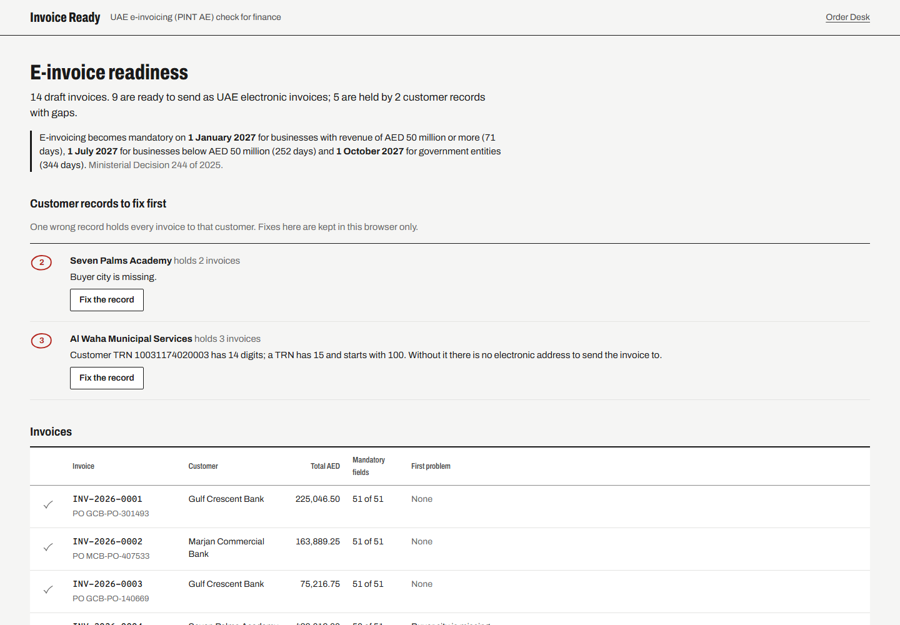
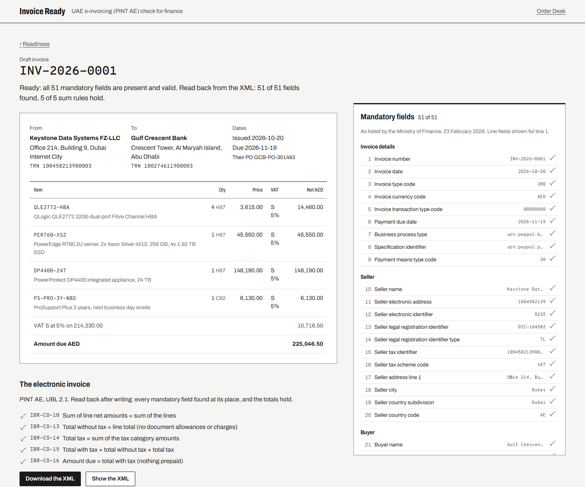

# Invoice Ready

Finance's next step after [Order Desk](https://github.com/f20230125-sudo/order-desk): turn delivered orders into
UAE electronic invoices, and see before go-live which ones would be rejected and why.

**Live:** https://invoice-ready-ae.vercel.app (made-up companies and invoices)



## Why

From **1 January 2027** (businesses with revenue of AED 50 million or more) and **1 July 2027** (everyone else),
invoices between businesses in the UAE must be sent as structured electronic invoices in the Peppol PINT AE
format through an accredited service provider (Ministerial Decisions 243 and 244 of 2025). An invoice that lacks
one of the mandatory fields, or carries a TRN with a digit missing, cannot be delivered. Most of these failures
come from master data, not from the invoice: one wrong customer record holds every invoice to that customer.

## What it does

- **Checks every draft invoice against the 51 mandatory fields** of a UAE electronic tax invoice, in the order and
  wording of the Ministry of Finance's list ("UAE Electronic Invoice Mandatory Fields", version 1.0, 23 February
  2026), each tied to its PINT AE business term and UBL element.
- **Checks the codes and the arithmetic:** TRN of 15 digits starting 1 and ending 03 (`/^1\d{12}03$/`, IBR-132-AE), the electronic address as the TIN (the
  TRN's first 10 digits) under scheme 0235, invoice type 380 or 480, the 8-position transaction type, tax
  categories S, Z and O with the standard rate at 5%, real dates with payment not due before issue, and an
  export flagged invoice that still charges VAT. UAE addresses use emirate codes, trade licences require an
  issuing authority, and exports require an overseas delivery address. Every supplied delivery address needs a
  permitted country code and, in the UAE, a permitted emirate code. Payment, country and Rec 20/21 unit codes
  are checked against the PINT AE lists; type 480 only permits E, O or Z and requires buyer legal registration
  and its type. Categories E, AE and N, non-AED currencies and flags with unsupported dependent fields are held.
  Out-of-scope (O) percentages are omitted from the XML and treated as not applicable in presence checks.
- **Says what to fix and where**, in one sentence: on the invoice, in the customer record, or in our company record.
  "Customer TRN 10031174020003 has 14 digits; a TRN has 15 digits, starts with 1 and ends in 03."
- **Puts customer records first.** Fix a record on the page and every invoice it held is released (kept in your
  browser only). Forms submit only changed fields; saves use persisted corrections as authoritative, and
  corrections and undo synchronize across tabs through storage events.
- **Writes the PINT AE XML** (UBL 2.1) and **reads it back** the way a receiving system would: every mandatory field
  found at its path, and the Peppol sum rules IBR-CO-10, 13, 14, 15 and 16 recomputed from the XML.



## Sources

| What | Where |
|---|---|
| The 51 / 49 mandatory fields, TIN as the first 10 TRN digits, scheme 0235, legal registration types TL, EID, PAS, CD | UAE Ministry of Finance, [UAE Electronic Invoice Mandatory Fields v1.0](https://mof.gov.ae/wp-content/uploads/2026/02/UAE-Electronic-Invoice-mandatory-fields_V-1.0-23Feb2026.pdf) |
| Business terms (IBT, BTAE) and UBL paths | Peppol [PINT AE semantic model and syntax binding](https://docs.peppol.eu/poac/ae/pint-ae/trn-invoice/syntax/) |
| Tax categories, invoice type codes, transaction type positions | PINT AE [code lists](https://docs.peppol.eu/poac/ae/pint-ae/trn-invoice/codelist/) |
| Permitted unit codes, including X-prefixed packaging codes | PINT AE [UN/ECE Rec 20/21 list](https://docs.peppol.eu/poac/ae/pint-ae/trn-invoice/codelist/UNECERec20/), PDK 1.4.4, 29 July 2026; stored locally in `src/lib/units.ts` |
| Sum and rounding rules | PINT AE [business rules](https://docs.peppol.eu/poac/ae/pint-ae/trn-invoice/businessrule/) |
| Go-live dates | Ministerial Decision 244 of 2025, as amended; MoF e-invoicing page |

**Checked, not assumed:** the specification identifier `urn:peppol:pint:billing-1@ae-1` comes from the PINT AE
document type identifier. The business process value `urn:peppol:bis:billing` is the Peppol billing process; I
did not find it stated on the PINT AE pages, so confirm it against the official example files before production
use. UAE country subdivisions use the emirate codes required by PINT AE rule IBR-128-AE.

## How it is built

TypeScript, React and Vite, no server: everything runs in the browser.

- [`src/lib/fields.ts`](src/lib/fields.ts): the 51 fields, each with its number, section, business term, UBL path and
  how its value is taken from the invoice and the master data.
- [`src/lib/validate.ts`](src/lib/validate.ts): presence, formats, codes and line rules, each finding one sentence
  with where to fix it.
- [`src/lib/money.ts`](src/lib/money.ts), [`compute.ts`](src/lib/compute.ts): all amounts in whole fils, so sums never
  pick up floating-point dust; decimal quantities multiply with scaled integers and round half up to fils,
  equivalent decimal rates share one VAT breakdown, and VAT rounds on each category's taxable total.
  Nonfinite quantities and line nets outside the safe integer range are held without breaking XML read-back.
- [`src/lib/ubl.ts`](src/lib/ubl.ts), [`readback.ts`](src/lib/readback.ts): write the UBL XML, parse it back, find every
  field by its path and recompute the totals.
- Sample data: [`tools/export_samples.py`](tools/export_samples.py) turns Order Desk's synthetic delivered orders into
  14 draft invoices, with two realistic gaps in the customer file (a TRN with a digit missing, an address with no
  city) and one zero-rated export to an overseas warehouse.

## Run it

```bash
npm ci
npm run dev          # http://127.0.0.1:5190
npm test             # 71 unit tests: money, the field list, VAT and code rules, XML read-back
npm run e2e          # 9 browser tests, with axe accessibility checks in light and dark
```

## Limits

- Tax invoices only (the 51-field list); the 49-field commercial invoice and credit notes are not covered.
- One tax category per invoice is shown in the checklist; the XML writes every category.
- Exempt lines (E) are held: exemption reason codes and category-specific XML are not supported yet.
- Category N is held: its special VAT breakdown treatment is not supported yet (IBR-108-AE).
- Reverse-charge lines (AE) are held: goods or services classification and standard item identifiers under
  scheme 0160 are not supported yet (IBR-166-AE, IBR-174-AE).
- Only the all-zero transaction flags and the export flag are supported; free trade zone, deemed supply,
  margin scheme, summary invoice, continuous supply, agent billing and e-commerce flags are held until their
  dependent fields and tax handling are supported.
- Non-AED invoices are held: exchange rates and AED accounting amounts are not supported yet (IBR-159-AE).
- No document-level allowances or charges, no prepayments.
- It checks readiness and writes the file; sending goes through an accredited service provider, which this is not.
- Synthetic data only.

Built by Uzair Khan.
